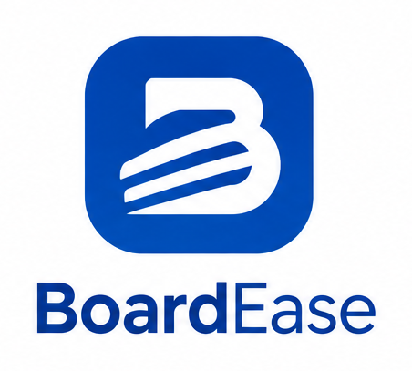
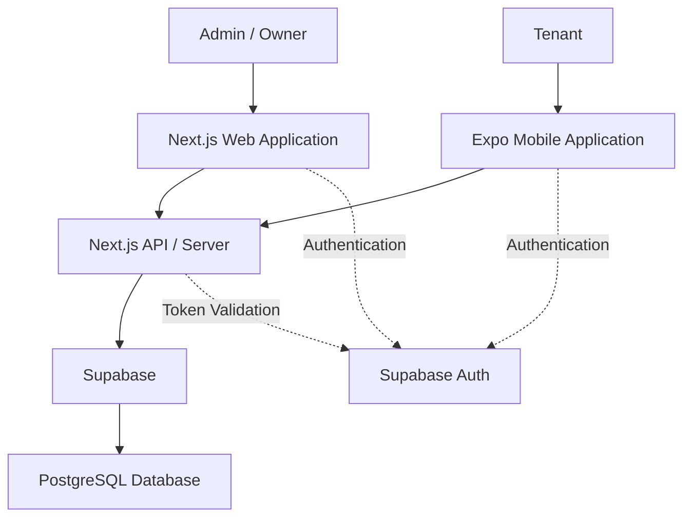
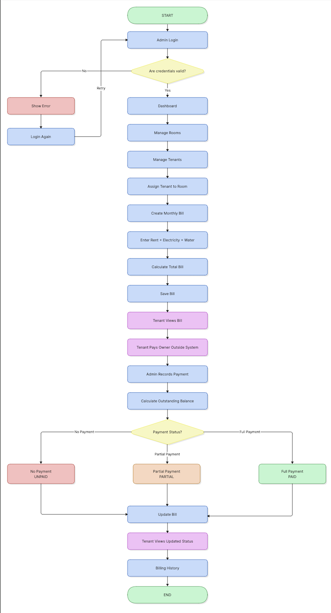
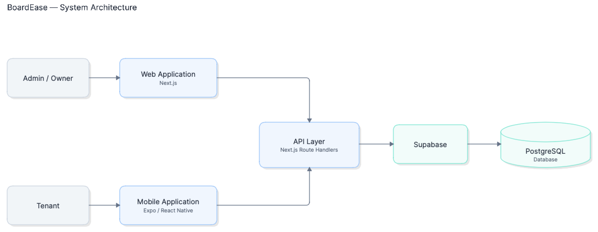
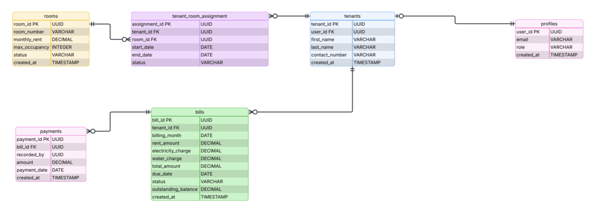

 <div align="center">



# BoardEase

### Boarding House Billing and Management System

**A web and mobile application for managing tenants, rooms, monthly billing, and payment records.**

<br />


<br />


<br />

**Project Status:** In Development

**Target Completion:** December 1, 2026

</div>

---

## 📖 Overview

**BoardEase** is a boarding house billing and management system designed to help boarding-house owners organize tenant information, room assignments, monthly bills, and payment records.

Instead of relying on manual recordkeeping, BoardEase provides two applications:

- **Web Application:** For owners and administrators to manage rooms, tenants, billing, and payments.
- **Mobile Application:** For tenants to register accounts and access their personal billing information.

The goal is to make boarding-house billing and payment tracking more organized and manageable.

## 👥 User Roles and Responsibilities

BoardEase has two primary user roles, each with different permissions and responsibilities.

### 🖥️ Admin / Owner — Web Application

The Admin manages the boarding-house operations through the web application.

**Account Access**

- Admin accounts are provided by the system owner or authorized project administrator.
- Admins sign in using their assigned credentials.
- Public Admin registration is not available.

**Dashboard**

- View the administrative dashboard.

**Room Management**

- Add and manage rooms.
- Set monthly room rental rates.
- Configure maximum room occupancy.
- Monitor room information.

**Tenant Management**

- View and manage tenant records.
- Assign registered tenants to rooms.
- Manage tenant-specific rental amounts.

**Billing Management**

- Create monthly bills.
- Enter rent, electricity, and water charges.
- Automatically calculate total bills.
- Edit billing records when corrections are needed.
- View billing history.

**Payment Management**

- Record payments received from tenants.
- Support partial payments.
- Edit or delete incorrect payment records.
- Monitor payment status and outstanding balances.

### 📱 Tenant — Mobile Application

The Tenant uses the mobile application to manage their account and view personal billing information.

**Account Access**

- Register an account through the mobile application.
- Sign in and sign out.
- No Admin-provided account is required for initial tenant registration.

**Dashboard and Billing**

- View personal dashboard.
- View current monthly bill.
- View bill breakdown.
- View payment status.
- View outstanding balance.
- View billing history.

**Important:** Tenants can only access their own authorized records. After registration, their account must be properly associated with their tenant record before accessing tenant-specific information. The Admin handles room assignment.

---

## 🏗️ System Architecture

BoardEase uses a shared backend architecture. The Admin web application and Tenant mobile application communicate with the same Next.js API/backend.

### Architecture Overview



### Component Responsibilities

| Component          | Technology             | Responsibility                                              |
| ------------------ | ---------------------- | ----------------------------------------------------------- |
| Web Application    | Next.js                | Admin interface                                             |
| Mobile Application | Expo / React Native    | Tenant interface                                            |
| Backend / API      | Next.js Route Handlers | API requests, validation, authorization, and business logic |
| Database           | PostgreSQL             | Application data storage                                    |
| Backend Services   | Supabase               | Database and backend services                               |
| Authentication     | Supabase Auth          | User authentication and sessions                            |

**Architecture Notes:**

- The Next.js web application and API/backend are part of the same project.
- The Expo mobile application is a separate project.
- Both applications use the Next.js API/backend for application data.
- Supabase Auth handles user authentication.
- Protected API requests must validate authentication and authorization on the server.

---

## 🛠️ Technology Stack

### Frontend

- **Next.js** — Admin web application.
- **React Native** — Mobile application framework.
- **Expo** — Mobile development platform.

### Backend and Database

- **Next.js Route Handlers** — Backend API.
- **Supabase** — Backend services.
- **PostgreSQL** — Relational database.
- **Supabase Auth** — Authentication.

### Development and Collaboration

- **Figma** — UI/UX design.
- **Git** — Version control.
- **GitHub** — Repository hosting and collaboration.
- **Jira** — Project and sprint management.

---

## 📋 Business Rules

### 1. Account Registration and Access

**Admin**

- Admin accounts are provided by the system owner or authorized project administrator.
- Admins cannot publicly register through the application.

**Tenant**

- Tenants can register through the mobile application.
- Registration requires first name, last name, email, password, and contact number.
- The Admin can assign registered tenants to rooms.
- Tenant accounts must be securely linked to their corresponding tenant records.

### 2. Room Occupancy

- A room can accommodate one or multiple tenants.
- Each room has a maximum occupancy configured by the Admin.
- The system must prevent assignments that exceed the room's maximum occupancy.

**Example:** A room with a maximum occupancy of three cannot accept a fourth tenant while all three spaces are occupied.

### 3. Rent Management

- Each room has a default monthly rent.
- For shared rooms, the Admin can assign different rental amounts to individual tenants.
- Rent is not automatically divided equally.

### 4. Electricity and Water Charges

- The Admin manually enters monthly electricity charges.
- The Admin manually enters monthly water charges.
- Charges are not calculated using meter readings.

### 5. Monthly Bill Calculation

The system calculates the total bill using:

```text
Total Bill = Rent + Electricity + Water
```

**Example:**

| Description    |     Amount |
| -------------- | ---------: |
| Monthly Rent   |     ₱5,000 |
| Electricity    |       ₱800 |
| Water          |       ₱200 |
| **Total Bill** | **₱6,000** |

The Admin can edit a bill when corrections are required.

### 6. Payment Recording

- Tenants pay the owner directly outside BoardEase.
- BoardEase does not process or receive online payments.
- After receiving payment, the Admin records it in BoardEase.
- A bill can have multiple payment records.
- Partial payments are supported.
- The Admin can edit or delete incorrect payment records.

### 7. Payment Status and Outstanding Balance

Payment status is determined by the payments recorded against a bill.

| Status    | Condition                                                   |
| --------- | ----------------------------------------------------------- |
| `UNPAID`  | No payment has been recorded.                               |
| `PARTIAL` | Payments have been recorded but do not cover the full bill. |
| `PAID`    | Total recorded payments cover the full bill.                |

The outstanding balance is calculated using:

```text
Outstanding Balance = Total Bill - Total Payments
```

Payment status is derived from payment records rather than manually selected by the Admin.

### 8. Database Security

- Admin and Tenant permissions are enforced through role-based access control.
- Tenants can only access their own authorized records.
- Protected API requests must validate authentication and permissions.
- Users must not be able to change their own roles through client-side operations.

---

## 📐 Technical Diagrams

### Business Process Flowchart



### System Architecture Diagram



### Entity Relationship Diagram



---

## 🚀 Development Status

BoardEase is currently under development.

The project is organized into the following development modules:

| Module                         | Description                                  |
| ------------------------------ | -------------------------------------------- |
| Authentication & Authorization | Account authentication and role-based access |
| API & Backend Services         | Shared backend API and Supabase integration  |
| Admin Dashboard                | Administrative overview                      |
| Room Management                | Room information and occupancy               |
| Tenant Management              | Tenant records                               |
| Tenant-Room Assignment         | Assigning tenants to rooms                   |
| Billing                        | Monthly rent and utility billing             |
| Payment                        | Payment recording and balance tracking       |
| Billing History                | Historical billing records                   |
| Tenant Mobile App              | Tenant-facing application                    |
| Testing & Integration          | Application testing and integration          |

### Known Project Limitations

- No online payment processing or third-party payment gateway integration.
- Electricity and water charges are manually entered.
- The current scope focuses on boarding-house billing and management.

---

## 🚫 Out of Scope

The following features are not included in the current project scope:

- GCash, Maya, or bank payment integration.
- Online payment processing.
- Chat and messaging.
- Artificial intelligence features.
- SMS integration.
- Complex notification systems.
- Multiple boarding-house branches.
- Advanced accounting.
- Maintenance management.
- Inventory management.
- Booking and reservations.

---

## 👥 Development Team

| Role                      | Member                 |
| ------------------------- | ---------------------- |
| Project Manager & Backend | Hurveen Rayford Veloso |
| Fullstack Developer       | Kendall Bryant Maputi  |
| Fullstack Developer       | Joachim Ray Chiong     |
| Fullstack Developer       | Elijah Bes             |

---

<div align="center">

### BoardEase

**Making boarding-house billing and payment tracking easier and more organized.**

Developed as an academic software development project.

</div>
