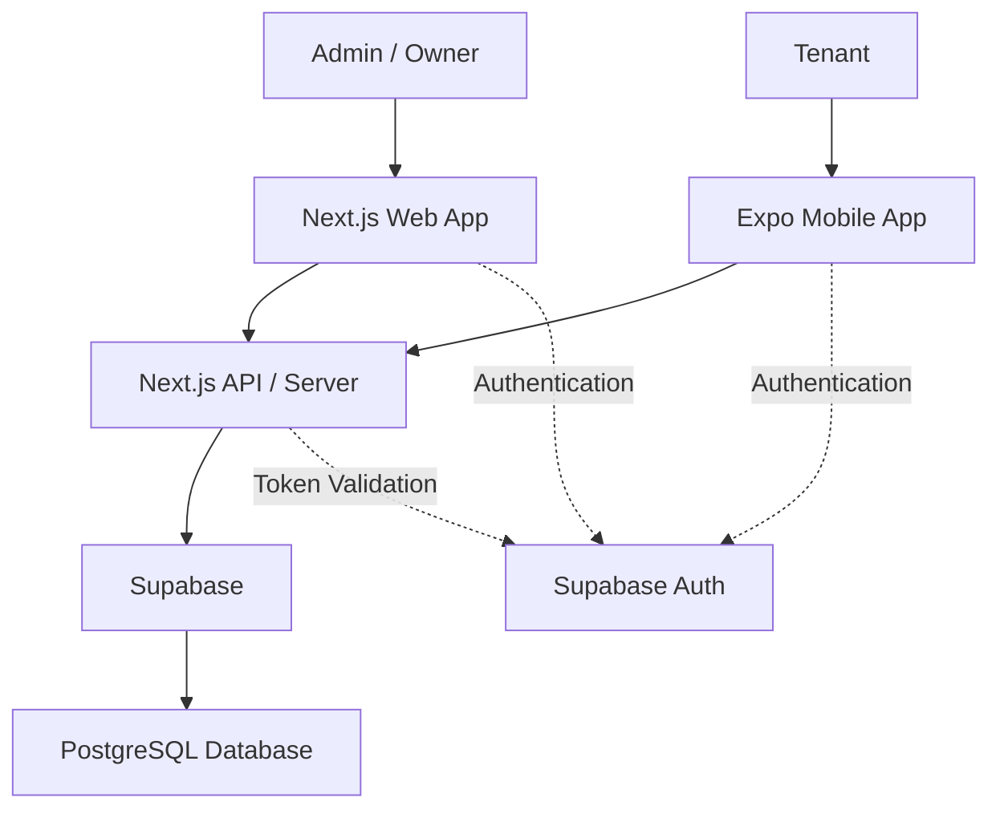
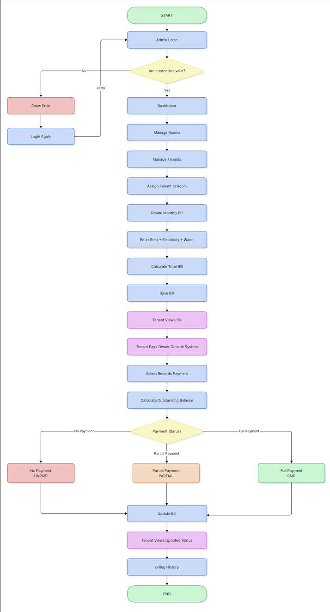
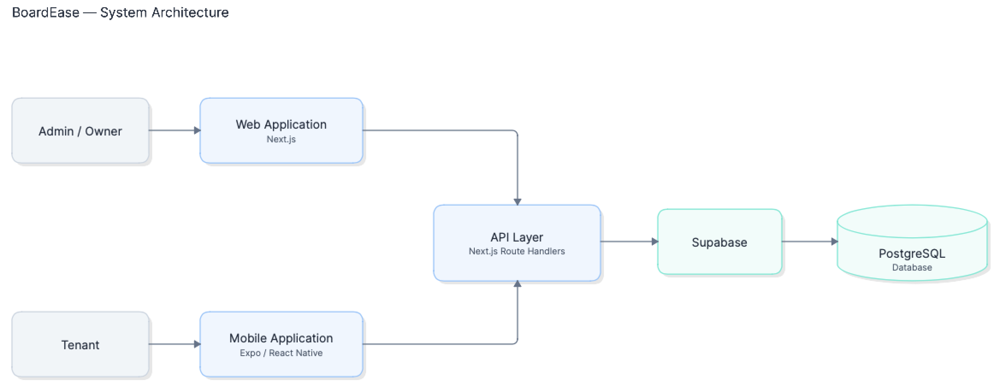
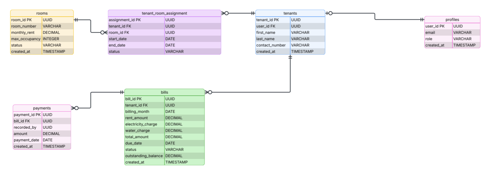

<div align="center">


# BoardEase

### Boarding House Billing and Management System

**A web and mobile solution for managing tenants, rooms, monthly billing, and payment records.**

<br />


<br />


<br />

**Project Status:** In Development

**Target Completion:** December 1, 2026

</div>

---

## 📖 Overview

**BoardEase** is a boarding-house billing and management system designed to help property owners organize tenant information, room assignments, monthly bills, and payment records.

Traditional manual recordkeeping can make it difficult for boarding-house owners to track rent, utility charges, partial payments, and outstanding balances.

BoardEase addresses these challenges through two applications:

- **Web Application:** Allows boarding-house owners and administrators to manage rooms, tenants, bills, and payment records.
- **Mobile Application:** Allows tenants to access their monthly billing information and payment status.

The goal is to make boarding-house management more organized, practical, and easier to maintain.

### Project Objectives

- Centralize tenant and room information.
- Simplify monthly rent and utility billing.
- Track paid, unpaid, and partially paid bills.
- Monitor outstanding balances.
- Provide tenants with access to their own billing records.
- Reduce manual recordkeeping.

---

## ✨ Features

> The following features represent the approved project scope. Implementation progress is tracked separately in the Development Status section.

### 🖥️ Admin / Owner — Web Application

#### Authentication and Dashboard

- Admin login and logout
- Role-based access control
- Admin dashboard

#### Room Management

- Add and manage rooms
- Set room rental rates
- Configure maximum room occupancy
- Manage room information

#### Tenant Management

- Manage tenant records
- Assign tenants to rooms
- Support single and shared room occupancy
- Configure tenant-specific rental amounts

#### Billing Management

- Create monthly bills
- Manage monthly rent charges
- Enter electricity charges
- Enter water charges
- Automatically calculate total bills
- Edit incorrect billing records
- View billing history

#### Payment Management

- Record tenant payments
- Support partial payments
- Edit or delete incorrect payment records
- Track payment status
- Monitor outstanding balances

### 📱 Tenant — Mobile Application

#### Account Management

- Tenant registration
- Tenant login and logout

#### Dashboard and Billing

- Tenant dashboard
- View current monthly bill
- View bill breakdown
- View payment status
- View outstanding balance
- View billing history

Tenant access is restricted to the tenant's own authorized records.

---

## 🏗️ System Architecture

BoardEase uses a shared backend architecture consisting of a Next.js web application, an Expo mobile application, and Supabase services.

### Architecture Overview



### Architecture Components

| Component        | Technology             | Responsibility                                              |
| ---------------- | ---------------------- | ----------------------------------------------------------- |
| Web Frontend     | Next.js                | Admin and owner interface                                   |
| Mobile Frontend  | Expo / React Native    | Tenant interface                                            |
| Backend / API    | Next.js Route Handlers | API requests, validation, authorization, and business logic |
| Database         | PostgreSQL             | Application data storage                                    |
| Backend Services | Supabase               | Database integration and services                           |
| Authentication   | Supabase Auth          | User authentication and sessions                            |

**Architecture Notes:**

- The Next.js web frontend and API/backend are part of the same Next.js project.
- The Expo mobile application is maintained as a separate application.
- Both applications use the Next.js backend for application data operations.
- Supabase Auth handles user authentication.
- Protected API requests require server-side authorization.
- Tenants must not be able to access another tenant's billing information.

---

## 🛠️ Technology Stack

### Frontend

| Technology   | Purpose                      |
| ------------ | ---------------------------- |
| Next.js      | Admin web application        |
| React Native | Mobile application framework |
| Expo         | Mobile development platform  |

### Backend and Database

| Technology             | Purpose             |
| ---------------------- | ------------------- |
| Next.js Route Handlers | Backend API         |
| Supabase               | Backend services    |
| PostgreSQL             | Relational database |
| Supabase Auth          | Authentication      |

### Development and Collaboration

| Technology | Purpose                              |
| ---------- | ------------------------------------ |
| Figma      | UI/UX design                         |
| Git        | Version control                      |
| GitHub     | Repository hosting and collaboration |
| Jira       | Project and sprint management        |

---

## 📋 Business Rules

### 1. Tenant Registration

Tenants can register their own accounts through the mobile application.

Registration information includes:

- First name
- Last name
- Email
- Password
- Contact number

After registration, the Admin can assign a tenant to a room.

Registration alone must not grant access to another tenant's records. Accounts must be securely linked to the correct tenant information.

### 2. Room Occupancy

A room can accommodate one or multiple tenants.

Each room has a maximum occupancy value configured by the Admin.

**Example:**

A room with a maximum occupancy of three tenants can accommodate Tenant A, Tenant B, and Tenant C.

A fourth tenant cannot be assigned while the room is at full capacity.

### 3. Rent Management

Each room has a default monthly rental rate.

For shared rooms, the Admin can assign different rental amounts to individual tenants.

BoardEase does not automatically divide the room's rent equally.

**Example:**

| Tenant   | Monthly Rent |
| -------- | -----------: |
| Tenant A |       ₱2,000 |
| Tenant B |       ₱2,500 |
| Tenant C |       ₱1,500 |

### 4. Electricity and Water Charges

The Admin manually enters electricity and water charges for each monthly bill.

BoardEase does not calculate utility charges from meter readings.

### 5. Monthly Bill Calculation

The total bill is calculated using:

```text
Total Bill = Rent + Electricity + Water
```

**Example:**

| Description    |     Amount |
| -------------- | ---------: |
| Monthly Rent   |     ₱5,000 |
| Electricity    |       ₱800 |
| Water          |       ₱200 |
| **Total Bill** | **₱6,000** |

The Admin can edit a bill when corrections are required.

### 6. Payment Recording

Payments are made directly to the boarding-house owner outside the BoardEase application.

The Admin records received payments in the system.

A bill can have multiple payment records, allowing partial payments.

Incorrect payment records can be edited or deleted by the Admin.

### 7. Payment Status

Payment status is determined by the total payments recorded against a bill.

| Status    | Condition                                                  |
| --------- | ---------------------------------------------------------- |
| `UNPAID`  | No payment has been recorded                               |
| `PARTIAL` | Payments have been recorded but do not cover the full bill |
| `PAID`    | Total payments cover the full bill                         |

The outstanding balance is calculated as:

```text
Outstanding Balance = Total Bill - Total Payments
```

Payment status is calculated from payment records rather than manually changed by the Admin.

### 8. Database Security

BoardEase uses role-based authorization to separate Admin and Tenant access.

Security requirements include:

- Only authorized Admin accounts can access management operations.
- Tenants can access only their own authorized records.
- Protected API requests must validate authentication and permissions.
- Client-side access must not allow users to change their own roles.
- RLS policies on `profiles` must not permit client-side `INSERT` or `UPDATE`, following the project's database security rule.

---

## 📐 Technical Diagrams

### Business Process Flowchart

The business process diagram illustrates the planned workflow for tenant management, billing, and payment recording.



### System Architecture Diagram

The system architecture diagram illustrates the relationships between the web application, mobile application, backend, and Supabase services.



### Entity Relationship Diagram

The ERD illustrates the planned database tables and relationships.



---

## 🚀 Development Status

BoardEase is currently under active development.

### Sprint 1 — Authentication and Authorization

The team has reported completing the first sprint, covering:

- Supabase authentication setup
- Authentication integration testing
- Authentication UI design
- Admin login
- Tenant login
- Role-based access control
- Logout functionality

**Repository verification:** Confirm that each completed task has been reviewed, merged into the main branch, and demonstrated successfully before treating it as verified implementation.

### Planned Development Modules

| Module                         | Description                                 |
| ------------------------------ | ------------------------------------------- |
| Authentication & Authorization | User authentication and role-based access   |
| API & Backend Services         | Shared backend API and Supabase integration |
| Admin Dashboard                | Management overview                         |
| Room Management                | Room information and occupancy              |
| Tenant Management              | Tenant records                              |
| Tenant-Room Assignment         | Room assignment operations                  |
| Billing                        | Monthly rent and utility billing            |
| Payment                        | Payment recording and balances              |
| Billing History                | Historical billing records                  |
| Tenant Mobile App              | Tenant-facing billing interface             |
| Testing & Integration          | Application testing and integration         |

### Demo / Simulated Functionality

No simulated functionality has been verified from the repository.

### Known Limitations

- No online payment processing.
- Utility charges require manual entry.
- The system is scoped to boarding-house billing and management.
- Automated test coverage has not yet been verified.
- Production deployment status has not yet been verified.

---

## ⚙️ Getting Started

> The following setup requirements are based on the selected technology stack. Exact commands and environment-variable names must be confirmed against the repository before use.

### Prerequisites

- Node.js
- Git
- A compatible Node.js package manager
- A Supabase project
- An environment capable of running Next.js and Expo applications

### Installation

Repository-specific installation instructions are pending verification.

Before running the project:

1. Clone the correct repository.
2. Install dependencies using the package manager specified by the project.
3. Configure the required Supabase environment variables.
4. Start the Next.js application using its documented script.
5. Start the Expo application using its documented script.

### Environment Configuration

Environment variables must match the names expected by the actual application source code.

Never commit real credentials, service-role keys, or `.env` files containing secrets.

### Development Commands

Exact commands will be documented after verifying the project's `package.json` files and repository structure.

---

## 🧪 Testing and Validation

The following are the intended testing areas for BoardEase:

### Authentication and Authorization

- Admin login and logout
- Tenant login and logout
- Invalid login handling
- Role-based route restrictions
- Unauthorized API request handling
- Tenant data ownership

### Room and Tenant Management

- Room creation and editing
- Maximum occupancy validation
- Tenant assignment restrictions

### Billing and Payments

- Monthly bill calculation
- Electricity and water charge handling
- Partial payment recording
- Payment status calculation
- Outstanding balance calculation

**Test results:** Automated test commands and passing results have not yet been verified against the repository.

---

## 🎬 Manual Demonstration

The following is the intended demonstration workflow. Use only the steps supported by the currently implemented application.

1. Launch the Admin web application.
2. Sign in using an authorized Admin account.
3. Demonstrate the available Admin features.
4. Verify that Admin-only access is protected.
5. Log out.
6. Launch the Tenant mobile application.
7. Sign in using an authorized Tenant account.
8. Demonstrate the available Tenant features.
9. Verify that the Tenant cannot access Admin-only functionality.
10. Log out and confirm the session has ended.

---

## 🔧 Troubleshooting

### Supabase Connection Issues

Verify that the application has the correct Supabase configuration and required environment variables.

### Authentication Problems

Verify the Supabase Auth configuration, user session, and assigned role.

### Application Startup Problems

Ensure dependencies are installed and the correct development scripts are being used.

---

## 🚫 Out of Scope

The following features are not part of the current BoardEase project:

- Online payment processing
- GCash, Maya, or bank payment integration
- Chat and messaging
- Artificial intelligence features
- SMS integration
- Complex notifications
- Multiple boarding-house branches
- Advanced accounting
- Maintenance management
- Inventory management
- Booking and reservations

---

## 👥 Development Team

| Role                      | Member                 |
| ------------------------- | ---------------------- |
| Project Manager & Backend | Hurveen Rayford Veloso |
| Fullstack Developer       | Kendall Bryant Maputi  |
| Fullstack Developer       | Joachim Ray Chiong     |
| Fullstack Developer       | Elijah Bes             |

---

## 📊 Project Evidence Checklist

The following categories are provisional and can be adjusted if an official evaluation rubric is provided.

| Category           | Supporting Evidence                                   |
| ------------------ | ----------------------------------------------------- |
| Problem and Impact | Overview and Project Objectives                       |
| Technical Design   | System Architecture and Technical Diagrams            |
| Functionality      | Features and Development Status                       |
| Technical Quality  | Evidence needed: code review and test results         |
| Collaboration      | Team Roles, GitHub commits, issues, and pull requests |
| Documentation      | README and technical diagrams                         |
| Demonstration      | Evidence needed: working demo or video                |
| Originality        | Evidence needed: project-specific design decisions    |

---

## ✅ Submission Checklist

- [ ] Verify all documented features against the source code.
- [ ] Confirm that the logo and diagram files exist.
- [ ] Verify development setup commands.
- [ ] Confirm required environment-variable names.
- [ ] Document actual test results.
- [ ] Prepare screenshots of implemented features.
- [ ] Prepare the application demonstration.
- [ ] Check for accidentally committed secrets.
- [ ] Verify all GitHub documentation links.
- [ ] Confirm all completed work is merged into the main branch.

---

## 📄 License

A repository license has not yet been confirmed.

Add the appropriate license information once the team has selected and committed a license file.

---

<div align="center">

### BoardEase

**Making boarding-house billing and payment tracking easier and more organized.**

Developed as an academic software development project.

</div>
